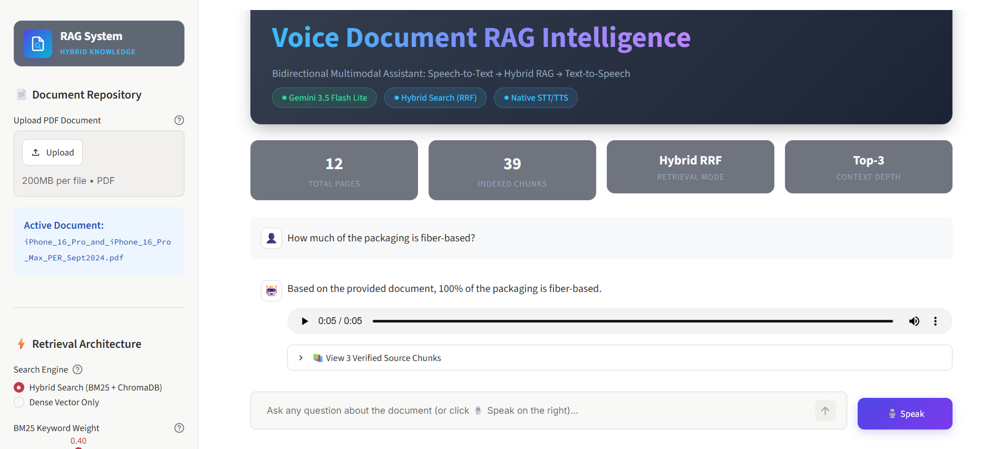

# Voice-Interactive Document RAG Intelligence: Advanced Hybrid Search Pipeline

[](https://www.python.org/)
[](https://streamlit.io/)
[](https://www.langchain.com/)
[](https://www.trychroma.com/)
[](https://ai.google.dev/)

An enterprise-grade, multimodal **Retrieval-Augmented Generation (RAG)** platform featuring bidirectional voice interaction (**STT &rarr; LLM &rarr; TTS**), **Hybrid Search (BM25 + ChromaDB Dense Vectors via Reciprocal Rank Fusion)**, and strict source grounding.

---

## Application Preview



---

## Evolution: Naive RAG vs. Advanced Hybrid RAG

| Feature | Naive RAG (Basic Baseline) | Advanced Hybrid RAG (This Project) |
| :--- | :--- | :--- |
| **Retrieval Engine** | Dense vector similarity search only | **Hybrid Search**: Sparse Lexical (`BM25`) + Dense Semantic (`ChromaDB`) fused via **Reciprocal Rank Fusion (RRF)** |
| **Keyword Precision** | Often misses exact numbers, product codes, or acronyms | Combines exact token matches with semantic understanding; runtime adjustable weighting |
| **Input Modalities** | Typed text input only | **Bidirectional Multimodal**: Zero-dependency Voice Microphone (**STT**) + Typed Text |
| **Output Modalities** | Raw text block | **Dual-Mode**: Streamed text response + Verified Source Chunk Accordion + Neural **TTS Audio Player** |
| **Vector Store Resilience** | Prone to HNSW disk segment corruption / dimension locks | **Self-Healing VectorStore**: Automatic detection and recovery for damaged HNSW segments |
| **C++ Build Requirements** | Requires MSVC C++ Build Tools for `PyAudio` | **Zero C++ Build Tools Needed**: Native cross-platform microphone capture powered by `sounddevice` |
| **Document Ingestion** | Hardcoded single PDF in notebook script | **Dynamic Ingestion**: Drag-and-drop upload for any PDF report with sanitization & auto-indexing |
| **Architecture** | Monolithic Jupyter Notebook (`.ipynb`) | **Production Modular System**: Clean `src/` hierarchy, Streamlit Web App, Standalone Script, and CLI |

---

## Core System Architecture

```
                                  +-------------------+
                                  |    PDF Document   |
                                  +---------+---------+
                                            |
                                  (PyPDFLoader Engine)
                                            |
                                            v
                                +-----------------------+
                                | Recursive Text Split  |
                                |  (1000 ch / 200 ov)   |
                                +-----------+-----------+
                                            |
                         +------------------+------------------+
                         |                                     |
                         v                                     v
                 +---------------+                     +---------------+
                 | BM25 Retriever|                     | ChromaDB Store|
                 | (Lexical/Word)|                     | (Dense Vector)|
                 +-------+-------+                     +-------+-------+
                         |                                     |
                         +------------------+------------------+
                                            |
                                            v
                                +-----------------------+
                                | Reciprocal Rank Fusion|
                                | (RRF Hybrid Retriever)|
                                +-----------+-----------+
                                            |
   User Microphone                          | Top-K Document
   +--------------+                         | Chunks + Metadata
   | Native Voice |                         |
   +-------+------+                         v
           | (STT)                  +-----------------+
           +----------------------->| LCEL RAG Chain  |
              Question String       | (Gemini Flash)  |
                                    +--------+--------+
                                             |
                              +--------------+--------------+
                              |                             |
                              v                             v
                   +----------------------+      +----------------------+
                   |   Text & Citations   |      |   Neural Audio TTS   |
                   | - Formatted Answer   |      | - Vocalizes ONLY the |
                   | - Verified Chunks    |      |   final answer text  |
                   | - Page Number Badges |      | - Embedded player    |
                   +----------------------+      +----------------------+
```

---

## Key Features & Highlights

### 1. 🎙️ Native Voice Input (Speech-to-Text)
- **Zero-Dependency Microphone Capture**: Built using native `sounddevice` and Windows multimedia audio buffers, completely bypassing `PyAudio` and eliminating the need for Microsoft Visual C++ Build Tools.
- **Dynamic In-Place Button State**: Clicking **🎙️ Speak** immediately transitions the button to **🔴 Listening...** in place without obstructive banners or layout shifting.
- **Automatic Silence Detection**: Detects natural conversational pauses to conclude voice input automatically.

### 2. ⚡ Hybrid Search & Reciprocal Rank Fusion (RRF)
- Combines sparse lexical keyword retrieval (`BM25`) with dense vector semantic search (`ChromaDB`).
- Eliminates common vector-only blind spots (part numbers, percentages, legal clauses, exact names).
- Dynamically adjust retrieval weights between BM25 and Semantic Vectors in real time via sidebar sliders.

### 3. 🛡️ Self-Healing ChromaDB Vector Store
- Automatically validates vector store integrity on startup and during queries.
- Built-in recovery catches missing/corrupted HNSW segment reader errors (`Nothing found on disk`), deletes broken segments, and rebuilds fresh embeddings seamlessly.
- Includes a manual **🔄 Rebuild Vector Index** control in the sidebar for on-demand database resets.

### 4. 🔊 Neural Text-to-Speech (TTS)
- Asynchronously synthesizes answers using high-definition neural voices (`edge-tts`) with offline `pyttsx3` fallback.
- **Smart Markdown Stripping**: Strips formatting symbols (bullet points, asterisks, citations) before vocalization to produce natural-sounding speech.
- **Answer-Only Vocalization**: Only synthesizes the final synthesized answer, leaving contextual sources cleanly categorized for reading.

### 5. 📚 Source Transparency & Grounding
- Displays verified context citations in an expandable accordion under each response.
- Inspect exact chunk text snippets alongside original PDF source page numbers.

### 6. 🎨 Modern Glassmorphic Enterprise UI
- Clean, responsive dashboard designed with custom CSS styling, dark-mode gradient headers, and real-time metric cards.
- Integrated file uploader allows dragging and dropping any new document to index and query immediately.

---

## Project Structure

```
d:\Study\AI\Rag\
├── assets/
│   └── image.png         # UI sample screenshot for documentation
├── app.py                # Modern Streamlit Web Application (Phase 1)
├── rag_pipeline.py       # Standalone end-to-end pipeline script
├── main.py               # Modular CLI launcher (interactive voice or text)
├── requirements.txt      # Project dependencies
├── README.md             # Complete project documentation
├── .env                  # Environment variables & API keys (never committed)
├── .env.example          # Environment variable template
├── .gitignore            # Git exclusion rules
├── data/                 # PDF document repository
│   └── iPhone_16_Pro_and_iPhone_16_Pro_Max_PER_Sept2024.pdf
├── src/                  # Modular package architecture
│   ├── __init__.py
│   ├── config.py         # System configuration & environment loaders
│   ├── audio/            # Voice processing modules
│   │   ├── __init__.py
│   │   ├── stt.py        # Native sounddevice Speech-to-Text engine
│   │   └── tts.py        # Asynchronous edge-tts and pyttsx3 fallback
│   └── rag/              # Retrieval-Augmented Generation core
│       ├── __init__.py
│       ├── loader.py     # PDF extraction (PyPDFLoader)
│       ├── splitter.py   # Recursive semantic text chunking
│       ├── vectorstore.py# ChromaDB integration & self-healing management
│       ├── hybrid_retriever.py # Native RRF Hybrid Retriever (BM25 + Vector)
│       └── chain.py      # LangChain LCEL chain definitions
└── chroma_db/            # Persistent local Chroma vector database
```

---

## Models Configured

- **Embedding Model**: `gemini-embedding-001` (768-dimensional semantic embeddings)
- **LLM Model**: `gemini-3.5-flash-lite` (Fast, high-accuracy generative model)

Configure these in `.env`:
```ini
GEMINI_API_KEY=your_gemini_api_key_here
EMBEDDING_MODEL=gemini-embedding-001
LLM_MODEL=gemini-3.5-flash-lite
```

---

## Installation & Setup

### 1. Clone the Repository
```bash
git clone https://github.com/GOKUL05102003/PDF_RAG_Pipeline.git
cd PDF_RAG_Pipeline
```

### 2. Install Dependencies
```bash
pip install -r requirements.txt
```

### 3. Configure API Key
Create or update your `.env` file in the project root:
```ini
GEMINI_API_KEY=your_google_gemini_api_key
EMBEDDING_MODEL=gemini-embedding-001
LLM_MODEL=gemini-3.5-flash-lite
```

---

## Execution Modes

### Option 1: Modern Web Application (Recommended)
Launch the Streamlit interactive dashboard:
```bash
streamlit run app.py
```
- Query via typed text or the **🎙️ Speak** microphone button on the right.
- Adjust hybrid search weights and top-k depth in real time.
- Listen to responses directly through the embedded audio player.

### Option 2: Standalone Flow Script
Run the complete reference RAG pipeline in terminal:
```bash
python rag_pipeline.py
```

### Option 3: Modular Command-Line Interface (CLI)
```bash
# Interactive mode (choice between voice or keyboard input)
python main.py

# Direct CLI query
python main.py --query "What percentage of packaging is fiber-based?"
```

---

## Troubleshooting

- **Microphone Permissions**: Ensure Windows microphone access is enabled under `Settings > Privacy & security > Microphone`.
- **ChromaDB Segment Issues**: If an index ever becomes corrupted due to abrupt process termination, click **🔄 Rebuild Vector Index** in the sidebar or restart `app.py` for automated self-healing.
- **Audio Output**: If online neural TTS is temporarily unreachable, the system automatically falls back to local offline `pyttsx3` speech synthesis.

---

## License

This project is licensed under the MIT License.
